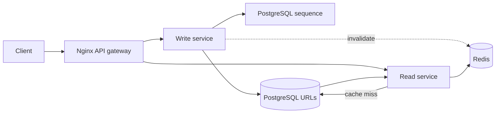

# Bitly — a URL shortening system design lab

A complete learning app built from scratch: separate FastAPI read/write services (Python), an Nginx API gateway, PostgreSQL 16, Redis 7 and a lightweight HTML/CSS/JavaScript frontend. You do not need Node.js. The attached drawing is an architecture reference; the interface provides a matching architecture overview alongside a link management dashboard.

For development, start with [AGENTS.md](AGENTS.md) and the focused [feature map](docs/feature-map.md). Reference docs cover [architecture](docs/architecture.md), [decisions](docs/decisions.md), [deployment commands](docs/deployment.md), [current handoff](docs/status.md), and [working efficiently with an LLM](docs/working-efficiently.md). These keep routine coding context small; this README remains the full beginner setup and cost guide.

## Start locally

Install Docker Desktop with Compose and Python 3 (used by the local deployment script and tests). The app itself runs on Python 3.12 inside Docker; no host pip installation is needed. Start Docker Desktop, then run from this directory:

```bash
./scripts/local-deploy.sh
./scripts/test.sh
```

Open http://localhost:8000. Create an account with your email and a password of 12–128 characters, or sign in. Create a link, optionally provide a case-sensitive alias and local expiration time, then open its short URL. The browser converts your expiration to UTC. The JWT stays in page memory; refreshing or signing out clears it, and you must sign in again.

The deploy script generates random credentials on first run, builds the image, starts the five containers, and waits for health. Re-running it updates the app and preserves data. `.env.example` shows all settings; never commit `.env`. Passwords generated by the scripts are hex to avoid URL-encoding problems in DATABASE_URL. If configuring your own password, use hex/alphanumeric characters or encode it appropriately.

```bash
./scripts/local-destroy.sh          # stop containers, preserve PostgreSQL data
./scripts/local-destroy.sh --purge  # remove containers AND the database volume
```

The purge does not remove `.env`, images or source. Docker Compose labels identify the `bitly-lab` project; PostgreSQL's volume also has `project=bitly-lab`. Do not use global Docker prune commands when you have other projects.

## What you can do

| Operation | Endpoint | Authorization |
|---|---|---|
| Register an account | POST `/api/auth/register` | Public |
| Sign in and receive JWT | POST `/api/auth/login` | Public |
| Current user | GET `/api/auth/me` | Signed-in user JWT |
| Create URL and optional alias/expiration | POST `/api/links` | Signed-in user JWT |
| List your URLs (100 per page, `?offset=100`) | GET `/api/links` | Signed-in user JWT |
| Retrieve destination and metadata | GET `/api/links/{code}` | Public |
| Update destination and expiration | PUT `/api/links/{code}` | Signed-in user JWT (owner only for existing links) |
| Delete URL | DELETE `/api/links/{code}` | Signed-in user JWT (owner only for existing links) |
| Follow short URL | GET `/s/{code}` | Public, 302 redirect |
| Dependency status | GET `/health` | Public |

Interactive API documentation: http://localhost:8000/docs. Register or sign in to obtain `access_token`, then use the Swagger **Authorize** button or send `Authorization: Bearer YOUR_JWT` for management endpoints. PUT replaces both destination and expiration: omitted expiration clears it. Codes are immutable; create a new link to change an alias. Duplicate aliases return 409, invalid input 422, missing URLs 404 and expired URLs 410. An expired code remains occupied until deleted. URLs are validated as HTTP/HTTPS, but the server does not fetch or assess their content.

This version has individual user accounts and link ownership. Registration is open: anyone may register and then create links. List queries return only your links; update/delete queries match both the code and your user ID. Another user's link returns 404 on attempted changes to avoid revealing ownership. Public redirect and destination lookup remain available without sign-in.

Passwords are salted and hashed using Argon2id; plaintext passwords are never stored. Sign-in returns an HS256 JWT with `sub` (user ID), `iat`, `exp`, issuer and audience. Verification fixes the allowed algorithm, verifies the signature/claims, and checks that the user still exists and is active in PostgreSQL. Tokens expire after `JWT_TTL_MINUTES` (default 30). `JWT_SECRET` is a random signing secret generated by the scripts and must never be exposed to the browser. Every API replica must share the same signing secret. See [PyJWT validation](https://pyjwt.readthedocs.io/en/stable/usage.html) and [Argon2 password hashing](https://argon2-cffi.readthedocs.io/en/stable/howto.html).

Sign-out clears the browser token; it does not revoke a copied token, which remains usable until expiry. There are no refresh tokens, password reset, email verification or individual-session revocation in this lab. Turning off a user's `is_active` flag rejects their existing tokens; rotating JWT_SECRET rejects all existing tokens after app restart. Before unrestricted public deployment, add HTTPS, authentication rate limits and abuse controls.

## Deploy to Google Cloud

The default deployment is one Debian 12 Compute Engine `e2-micro` VM in `us-central1-a`, with a 20 GB `pd-standard` boot/database disk, an ephemeral public IPv4, a dedicated VPC/subnet and a firewall allowing SSH (22) and HTTP (80) only from your public IPv4 `/32`. PostgreSQL and Redis stay inside Docker. No managed database, managed Redis, Kubernetes cluster, cloud load balancer or NAT gateway is provisioned.

Cloud deployment creates an empty database; it does not upload local data or local secrets. Use a dedicated GCP project to make resource identification and billing easier.

1. Install Terraform >=1.6 and the [Google Cloud CLI](https://cloud.google.com/sdk/docs/install). Create a cloud project and attach your billing account.
2. Authenticate the CLI and Terraform, select the project, and enable Compute Engine:

```bash
gcloud auth login
gcloud auth application-default login
gcloud config set project YOUR_PROJECT_ID
gcloud services enable compute.googleapis.com --project=YOUR_PROJECT_ID
```

The deployment identity needs permissions to manage Compute Engine networking, VMs and disks, enable APIs, and use OS Login with sudo. Typical project roles are Compute Admin, Service Usage Admin and Compute OS Admin Login (or narrower equivalent permissions). The VM does not need an attached service account for this application.

3. Create a project-scoped billing budget as described below.
4. Configure Terraform:

```bash
cp infra/gcp/terraform.tfvars.example infra/gcp/terraform.tfvars
```

Edit the file with your own values:

```hcl
project_id   = "YOUR_PROJECT_ID"
region       = "us-central1"
zone         = "us-central1-a"
allowed_cidr = "YOUR_PUBLIC_IPV4/32"
machine_type = "e2-micro"
```

`allowed_cidr` is the public IPv4 of the network you connect from, not the VM's IP or your Mac's private Wi-Fi IP. Update it if your network/VPN changes. Terraform automatically reads `infra/gcp/terraform.tfvars` because the script runs Terraform in that directory. The `.example` file is only a template.

5. Deploy:

```bash
./scripts/gcp-deploy.sh
```

Review the saved Terraform plan, then type `deploy`. The script creates infrastructure, waits for the startup script, uploads source, generates database/JWT secrets on the VM, builds containers and checks both services. It can be rerun for code updates. A failed deployment may leave billable resources; inspect logs, retry or clean up. Read each plan: replacing the VM/disk can erase data.

The VM and disk have labels `project=bitly-lab`, `environment=learning`, `managed_by=terraform`. Networking names are prefixed with `bitly-lab`, and the firewall targets that VM network tag. Terraform state is stored in `infra/gcp/terraform.tfstate`; keep it until destruction succeeds. Commit the provider lock file, but never commit state, plans, `.tfvars`, `.env` or private keys.

## Access and test the cloud app

The script prints a tunnel command; run it separately **on your Mac** and leave that terminal open:

```bash
gcloud compute ssh bitly-lab --project=YOUR_PROJECT_ID --zone=us-central1-a -- \
  -N -o ExitOnForwardFailure=yes -L 127.0.0.1:8080:localhost:80
```

Open [http://127.0.0.1:8080](http://127.0.0.1:8080), register a user, and create a link. Local users are not copied to GCP. The tunnel encrypts transport to the VM; direct `http://VM_PUBLIC_IP` also works from your allowed network but has no HTTPS. Use the tunnel for registration/sign-in/JWT traffic.

```bash
curl http://127.0.0.1:8080/health/read
curl http://127.0.0.1:8080/health/write
TEST_BASE_URL=http://127.0.0.1:8080 ./scripts/test.sh
```

Set Postman's `base_url` to `http://127.0.0.1:8080`. Cloud tests create users that remain after the run; use a learning database. Do not run the local service-isolation script against GCP.

To inspect infrastructure and services:

```bash
gcloud compute instances list --project=YOUR_PROJECT_ID
gcloud compute ssh bitly-lab --project=YOUR_PROJECT_ID --zone=us-central1-a
# On the VM:
cd /opt/bitly
sudo docker compose ps
sudo docker compose logs --tail=100 gateway read write
sudo docker stats --no-stream
sudo journalctl -u google-startup-scripts.service
```

If SSH fails, check OS Login roles and your current public IP against `allowed_cidr`. For startup failures, use `gcloud compute instances get-serial-port-output bitly-lab --project=YOUR_PROJECT_ID --zone=us-central1-a`. These five app services appear as Docker containers within one VM, not five separate Compute Engine instances.

## GCP cost estimate and Free Tier

Planning estimates checked October 10, 2026: USD, `us-central1`, 730 running hours/month, 20 GB provisioned standard disk, before taxes, promotional credits and transfer charges.

| Resource | List rate | Before Free Tier | With available eligible Free Tier |
|---|---|---:|---:|
| One e2-micro VM | $0.008376428/hour | about $6.11/month | $0 within eligible VM-hour allowance |
| 20 GB pd-standard disk | $0.04/GB-month | about $0.80/month | $0 within eligible disk allowance |
| One in-use public IPv4 | $0.005/hour | about $3.65/month | about $3.65/month; only one IP-hour/month is free |
| Base total | | **about $10.56/month** | **about $3.65/month**, plus excess usage |

The containerized gateway, Python services, PostgreSQL and Redis have no separate managed-service charge; their resource usage is part of the VM cost. The VPC/subnet/basic firewall configuration adds no separate hourly VM-like fee. No extra snapshots/backups or paid observability features are enabled by Terraform.

Free Tier covers one eligible e2-micro month's hours in us-central1/us-east1/us-west1, 30 GB-months of standard persistent disk and 1 GB of eligible outbound transfer from North America (excluding China/Australia). Allowances are shared across eligible usage, so other projects can consume them. Our defaults fit the VM/disk allowances; public IPv4 is not free for a whole month. Excess internet transfer, extra disks/snapshots, a different region or a larger machine can increase the bill.

Eligible new users receive $300 trial credits valid for 90 days. Credits can offset eligible charges while available; they do not make the stack permanently free. Check your balance, expiry and actual charges in Billing. The 1 GiB VM is tight for this stack; e2-small has more RAM but falls outside the free VM allowance.

Official sources: [VM rates](https://cloud.google.com/products/compute/pricing/general-purpose), [disk rates](https://cloud.google.com/compute/disks-image-pricing), [IPv4/network pricing](https://cloud.google.com/vpc/network-pricing), [Free Tier limits](https://docs.cloud.google.com/free/docs/free-cloud-features), [trial eligibility](https://cloud.google.com/signup-faqs).

An eight-hour overnight run costs roughly $0.04 for IPv4 if VM/disk allowances are available, before transfer and credits. Stopping the VM releases its ephemeral IP and stops compute use, but the disk remains allocated and may still cost money outside the disk allowance. Deleting the stack removes its disk too.

## Set budget alerts before deploying

Budget alerts are configured manually; **this Terraform stack does not create a budget or impose a spending cap**.

In Google Cloud Console → Billing → Budgets & alerts:

1. Create a monthly budget scoped to this project (for example $5 or $10).
2. Add actual-spend thresholds at 50%, 90% and 100%, plus forecasted 100%.
3. Verify notification recipients and credit treatment. Include/exclude promotional credits deliberately depending on whether you want alerts on gross usage or net costs.
4. Check Billing reports after deployment and confirm Free Tier deductions.

Notifications may be delayed and do not stop resources or guarantee that spending stays under the budget. See [Google's budget documentation](https://cloud.google.com/billing/docs/how-to/budgets).

## Stop, restart and destroy GCP resources

Run these on your Mac, replacing the project ID and zone if configured differently:

```bash
gcloud compute instances stop bitly-lab --project=YOUR_PROJECT_ID --zone=us-central1-a
gcloud compute instances start bitly-lab --project=YOUR_PROJECT_ID --zone=us-central1-a
gcloud compute instances list --project=YOUR_PROJECT_ID
```

Docker/containers restart automatically. The public IP can change on restart; reopen your SSH tunnel and update any URLs using the old public IP. Stopping preserves database data on the disk. To refresh Terraform's recorded IP without redeploying:

```bash
terraform -chdir=infra/gcp apply -refresh-only
terraform -chdir=infra/gcp output
```

To permanently remove the stack:

```bash
./scripts/gcp-destroy.sh
```

Review the destroy plan and type `destroy`. This deletes the VM, its boot/database disk, firewall and dedicated networking, including **all cloud users and links**. It keeps local data, source, the GCP project, billing link, enabled APIs and the console budget. Manually created snapshots or unrelated resources need separate cleanup. Keep Terraform state until destruction succeeds, then verify resources in Compute Engine/VPC and review Billing (reports can lag).

Optional backup before destruction, on the VM in `/opt/bitly`:

```bash
sudo docker compose exec -T postgres pg_dump --clean --if-exists -U bitly bitly > bitly-backup.sql
```

Copy the backup to your Mac using `gcloud compute scp` before deleting the VM. Database dumps contain user/link data and must stay out of Git. Restoring this dump replaces user/link tables and sequences: stop read/write containers, restore with `docker compose exec -T postgres psql -U bitly bitly < bitly-backup.sql`, then restart them. Flush the disposable Redis cache after restore to prevent stale destinations. Automated backups are not configured.

## Understand the system design



 This deployment implements separate read and write FastAPI processes/containers behind an Nginx API gateway. The gateway also serves the frontend. All five containers share one VM for cost savings, so they still share a host failure domain. PostgreSQL `nextval` safely allocates distinct numeric IDs across concurrent writers. Base62 converts an ID into a compact code. A primary-key uniqueness constraint arbitrates custom-alias races; generated IDs skip any alias collisions. Sequence gaps are expected after failed transactions/deletions. Codes are predictable, so short links are not private access tokens.

The URL table stores `code`, `original_url`, `created_at`, nullable `expires_at` and `created_by` referencing `users.id`. The users table stores ID, unique normalized email, Argon2id password hash, creation timestamp and active status. New links always receive the authenticated owner ID from the server; a client cannot choose an owner. Expiration is checked during reads; expired rows stay available to management and can be deleted. There is no scheduled cleanup job.

Redirect reads use **cache-aside**: Redis is checked first; on a miss PostgreSQL supplies the destination and Redis stores it for up to 30 seconds, bounded by expiration. Each cached entry includes the expiration timestamp and it is checked again on a hit. Updates/deletes commit to PostgreSQL then invalidate Redis. Redis failures fall back to PostgreSQL, and cached redirects do not depend on DB availability. `/health` requires DB but reports a Redis outage without making the app unhealthy.

A concurrent read can refill the cache after an update/delete invalidation, or invalidation can fail while Redis is down. This lab explicitly accepts stale redirects with a **30-second cache TTL** after mutation (an in-flight read can write a stale entry after the mutation); metadata retrieval always reads the DB. If immediate revocation is required, validate a database version/tombstone on each redirect, or use a coordinated cache protocol. This is a system design consistency tradeoff, not a promise of strict consistency.

This cheap stack has one failure domain: losing the VM loses availability and terminating it loses data. Redis is disposable; PostgreSQL has persistent local storage but no high availability. To grow it:

1. Add HTTPS, email verification/password recovery, authentication rate limiting and abuse handling.
2. Move PostgreSQL to Cloud SQL with backups and restore drills; Redis to Memorystore.
3. Put multiple stateless API containers behind a Google Cloud Application Load Balancer; scale the existing read and write services onto separate hosts according to traffic.
4. Add metrics for latency, error rate, cache hit rate, DB pool pressure, memory and disk capacity.
5. Handle distributed cache invalidation and read replicas carefully: replica lag can resurrect old values after writes.
6. Allocate ranges of sequence IDs to writers to reduce counter round trips at very high write rates; partition data only after measuring real bottlenecks.

These are future architecture exercises, not resources provisioned by this project. The existing PostgreSQL sequence is the authoritative counter; Redis must never become the only durable source of IDs.

## Troubleshooting and testing

`./scripts/test.sh` runs live integration tests with standard-library Python: CRUD, cache invalidation, expiration, alias conflicts, URL validation, authorization and concurrent unique code generation. It creates two temporary users and its own temporary links. Against the default local URL, it deletes those test users directly through Compose after removing its links. Against a custom TEST_BASE_URL, test accounts are retained; use an isolated test database. Run against local Compose, not a public production service. To point it elsewhere, set `TEST_BASE_URL`; tests register their own accounts. JWT claim tests read local JWT_SECRET only for the default local URL.

Useful commands:

```bash
docker compose ps
docker compose logs gateway read write
docker compose logs postgres
docker compose exec redis redis-cli DBSIZE
curl http://localhost:8000/health
```

If Docker is unavailable, start Docker Desktop. If port 8000 is busy, set PORT in `.env` (also set TEST_BASE_URL for tests). If cloud deployment fails, check Compute Engine API enablement, IAM/OS Login permissions and billing status. Destroy any partially created resources if abandoning the deployment.

## Read/write services and gateway deployment

Local and GCP deployments use the same five services through Compose. Only the Nginx gateway publishes a host port (8000 locally, 80 on GCP). Backends, PostgreSQL and Redis are accessible only within the Docker network. Existing user/link data, JWT signing secret and volume names are retained during the upgrade; `--remove-orphans` removes the superseded app container without deleting the volume.

| Request | Gateway destination |
|---|---|
| GET/HEAD `/api/links` or `/api/links/{code}` | Read service |
| POST/PUT/DELETE `/api/links` or `/api/links/{code}` | Write service |
| `/s/{code}` | Read service |
| `/api/auth/*` including register, login and me | Write service |
| `/`, `/static/*`, `/docs` | Gateway serves frontend/docs index |
| `/read/docs`, `/read/openapi.json` | Read service documentation |
| `/write/docs`, `/write/openapi.json` | Write service documentation |
| `/health/read`, `/health/write` | Individual service health |

`/health` reports the read service; the gateway container's health check checks **both** services. During a write outage, `/health` may still return 200 while the gateway's container health becomes unhealthy. This keeps a usable read endpoint without claiming the whole system is healthy. API errors and JWT Authorization headers are forwarded through the gateway. Each protected backend validates the JWT and active user itself. Unsupported HTTP methods reach a service that returns 405; they do not create a mutation route in the read service.

The write service owns schema initialization, password hashing/token issuance, mutations, sequence allocation and cache invalidation. The read service owns cached redirects, metadata lookup and the authenticated per-user list. Startup waits for write-service readiness before starting read to ensure the schema exists. At runtime reads do not call the write service: a write-service outage does not prevent existing links from resolving or listing. Registration/login/me are unavailable during a write outage.

The services share `app/common.py` and `app/auth.py`, one shared backend Dockerfile/source, PostgreSQL schema and database credentials in this lab. They have distinct entry points (`app.read:app`, `app.write:app`) and HTTP route sets and can be restarted independently. This is a read/write service split with shared storage, not fully isolated service-owned databases. Nginx dynamically resolves Docker DNS so replacing a backend container recovers after its short DNS cache expires. It is a self-hosted gateway, a reverse proxy running inside the VM.

```bash
./scripts/local-deploy.sh
./scripts/test.sh
# View individual logs or health:
docker compose logs gateway read write
curl http://localhost:8000/health/read
curl http://localhost:8000/health/write
# Restart only one backend:
docker compose restart read
# Deploy the same topology to GCP:
./scripts/gcp-deploy.sh
```

The GCP upload includes the gateway and frontend assets. Extra containers have no separate managed-service fee, but the VM has only 1 GiB RAM. Container limits total 768 MiB and bootstrap adds 1 GiB swap; a larger VM may be needed for sustained workloads. All containers share one host failure domain.

For a local failure drill, run `./scripts/test-isolation.sh`. It briefly stops each backend in turn, verifies the other service continues working through Nginx, then restores both and removes only its own temporary user/links. Do not run it while using the local app for other work. Nginx proxy behavior follows its [official proxy module documentation](https://nginx.org/en/docs/http/ngx_http_proxy_module.html#proxy_pass).

The nine live integration tests and read/write failure drill have passed through Nginx. Terraform configuration validation verifies syntax/provider compatibility; it does not prove billing eligibility or enforce a spending limit.

## Postman collection

Import `postman/bitly.postman_collection.json` and `postman/bitly.postman_environment.json` into Postman, select the imported environment, and run the folders in order. It automatically registers test users, obtains JWTs, exercises link CRUD and verifies ownership restrictions. See `postman/README.md` for local/GCP URLs, redirect settings and test-data cleanup.

## Connect desktop pgAdmin locally

To use pgAdmin installed on your computer, expose PostgreSQL on loopback only:

```bash
docker compose -f compose.yaml -f compose.local.yaml up -d --no-deps postgres
```

In pgAdmin, Register → Server: name `Bitly Local`, host `127.0.0.1`, port `5432`, maintenance database `bitly`, username `bitly`, and password from `POSTGRES_PASSWORD` in `.env`. Expand Databases → bitly → Schemas → public → Tables to inspect users and urls.

This optional override is not uploaded or used by GCP deployment. Local redeployment with the base Compose file removes the port mapping; reapply the override afterward if needed. If your machine already uses port 5432, change the override's host port to 5433 and use that port in pgAdmin.

