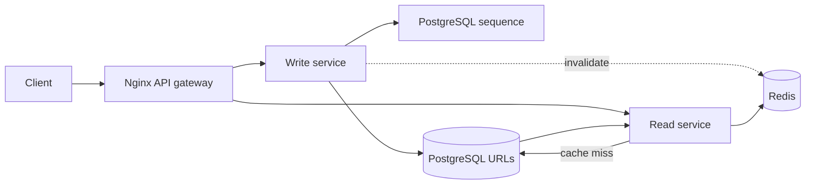

# Bitly — a URL shortening system design lab

A complete learning app built from scratch: separate FastAPI read/write services (Python), an Nginx API gateway, PostgreSQL 16, Redis 7 and a lightweight HTML/CSS/JavaScript frontend. You do not need Node.js. The attached drawing is an architecture reference; the interface provides a matching architecture overview alongside a link management dashboard.

## Start locally

Install Docker Desktop with Compose and Python 3 (used by the local deployment script and tests). The app itself runs on Python 3.12 inside Docker; no host pip installation is needed. Start Docker Desktop, then run from this directory:

```bash
./scripts/local-deploy.sh
./scripts/test.sh
```

Open http://localhost:8000. Create an account with your email and a password of 12–128 characters, or sign in. Create a link, optionally provide a case-sensitive alias and local expiration time, then open its short URL. The browser converts your expiration to UTC. The JWT stays in page memory; refreshing or signing out clears it, and you must sign in again.

The deploy script generates random credentials on first run, builds the image, starts the five containers, and waits for health. Re-running it updates the app and preserves data. `.env.example` shows all settings; never commit `.env`. Passwords generated by the scripts are hex to avoid URL-encoding problems in DATABASE_URL. If configuring your own password, use hex/alphanumeric characters or encode it appropriately.

```bash
./scripts/local-destroy.sh          # stop containers, preserve PostgreSQL data
./scripts/local-destroy.sh --purge  # remove containers AND the database volume
```

The purge does not remove `.env`, images or source. Docker Compose labels identify the `bitly-lab` project; PostgreSQL's volume also has `project=bitly-lab`. Do not use global Docker prune commands when you have other projects.

## What you can do

| Operation | Endpoint | Authorization |
|---|---|---|
| Register an account | POST `/api/auth/register` | Public |
| Sign in and receive JWT | POST `/api/auth/login` | Public |
| Current user | GET `/api/auth/me` | Signed-in user JWT |
| Create URL and optional alias/expiration | POST `/api/links` | Signed-in user JWT |
| List your URLs (100 per page, `?offset=100`) | GET `/api/links` | Signed-in user JWT |
| Retrieve destination and metadata | GET `/api/links/{code}` | Public |
| Update destination and expiration | PUT `/api/links/{code}` | Signed-in user JWT (owner only for existing links) |
| Delete URL | DELETE `/api/links/{code}` | Signed-in user JWT (owner only for existing links) |
| Follow short URL | GET `/s/{code}` | Public, 302 redirect |
| Dependency status | GET `/health` | Public |

Interactive API documentation: http://localhost:8000/docs. Register or sign in to obtain `access_token`, then use the Swagger **Authorize** button or send `Authorization: Bearer YOUR_JWT` for management endpoints. PUT replaces both destination and expiration: omitted expiration clears it. Codes are immutable; create a new link to change an alias. Duplicate aliases return 409, invalid input 422, missing URLs 404 and expired URLs 410. An expired code remains occupied until deleted. URLs are validated as HTTP/HTTPS, but the server does not fetch or assess their content.

This version has individual user accounts and link ownership. Registration is open: anyone may register and then create links. List queries return only your links; update/delete queries match both the code and your user ID. Another user's link returns 404 on attempted changes to avoid revealing ownership. Public redirect and destination lookup remain available without sign-in.

Passwords are salted and hashed using Argon2id; plaintext passwords are never stored. Sign-in returns an HS256 JWT with `sub` (user ID), `iat`, `exp`, issuer and audience. Verification fixes the allowed algorithm, verifies the signature/claims, and checks that the user still exists and is active in PostgreSQL. Tokens expire after `JWT_TTL_MINUTES` (default 30). `JWT_SECRET` is a random signing secret generated by the scripts and must never be exposed to the browser. Every API replica must share the same signing secret. See [PyJWT validation](https://pyjwt.readthedocs.io/en/stable/usage.html) and [Argon2 password hashing](https://argon2-cffi.readthedocs.io/en/stable/howto.html).

Sign-out clears the browser token; it does not revoke a copied token, which remains usable until expiry. There are no refresh tokens, password reset, email verification or individual-session revocation in this lab. Turning off a user's `is_active` flag rejects their existing tokens; rotating JWT_SECRET rejects all existing tokens after app restart. Before unrestricted public deployment, add HTTPS, authentication rate limits and abuse controls.

When upgrading from the shared-token version, `local-deploy.sh` and `aws-deploy.sh` append a new random JWT_SECRET to an existing `.env`. The old ADMIN_TOKEN is no longer accepted and may be removed. Startup adds the users table and nullable `urls.created_by` foreign key without deleting data. Pre-existing links remain public and unowned: no user can list/edit/delete them. Assign ownership only through a deliberate administrator DB migration; the first registrant does not inherit legacy links.

## AWS setup and deployment

Recommended learning deployment: one `t3.micro` EC2 VM with Docker Compose. It contains the gateway, read service, write service, PostgreSQL and Redis, in a dedicated VPC/public subnet in `us-east-1`. Only SSH and HTTP from your configured CIDR are permitted; database/cache ports are never exposed. No NAT gateway, load balancer, RDS, ElastiCache, domain or Elastic IP is provisioned. EC2's public IP is the URL and may change after stop/start. Short URLs from the old address then stop working.

Install Terraform >=1.6, AWS CLI v2, OpenSSH and tar. Configure AWS credentials via `aws configure` or AWS SSO (`aws sso login --profile your-profile` and `export AWS_PROFILE=your-profile`). Use a deployment identity authorized for EC2/VPC/key pairs and AWS Budgets, not root credentials. These scripts use your credentials locally; the instance gets no AWS IAM role.

```bash
ssh-keygen -t ed25519 -f ~/.ssh/bitly-lab
cp infra/terraform.tfvars.example infra/terraform.tfvars
```

Edit `infra/terraform.tfvars`:

- `allowed_cidr`: your actual public IPv4 with `/32` (the example address is a placeholder). Update this if your ISP changes your address.
- `ssh_public_key`: the complete contents of `~/.ssh/bitly-lab.pub`.
- `budget_email`: your email address; default budget is $15/month.
- `project`: a unique slug such as `bitly-lab`. Use separate project directories/Terraform state for future projects.

```bash
export SSH_KEY="$HOME/.ssh/bitly-lab"
./scripts/aws-deploy.sh
```

The script initializes Terraform, validates it, displays a saved plan and asks you to type `deploy` before spending money. It waits for cloud-init, uploads only application source, generates separate credentials on the VM, builds containers, and checks health. It can be re-run for code updates. A partial deployment can leave resources running; fix the problem and re-run, or destroy them. Inspect `/var/log/cloud-init-output.log` for bootstrap failures and `sudo docker compose logs` in `/opt/bitly` for application failures. Build-time swap helps the 1 GiB instance; it is not a performance substitute for RAM.

HTTP on the VM is unencrypted. Use SSH forwarding for all token-based management:

```bash
ssh -i "$SSH_KEY" -L 8080:localhost:80 ec2-user@PUBLIC_IP
# In the instance shell:
# Keep the tunnel running while using the browser.
```

Open http://localhost:8080 and register or sign in. Access via this tunnel encrypts transport to EC2. To share links with others, their IP must be included in the allowed network; the default intentionally permits only your address. A public version needs HTTPS and proper user access controls. Public HTTP links are suitable only for this restricted learning demo.

Terraform creates a dedicated VPC, subnet, route table, gateway, security group, key pair, VM, encrypted 10 GiB root EBS volume and account-wide monthly budget. Taggable resources carry `Project`, `Environment=learning`, `ManagedBy=Terraform`; the EBS volume is explicitly tagged too. AWS resources without provider tag support use names/state association. The budget deliberately covers the whole account so untagged IPv4 costs and other projects still trigger alerts. Budget names include the project slug.

Terraform state is local in `infra/terraform.tfstate`. Keep it safe: it is how Terraform knows what to delete. Do not delete state before cleanup. `infra/.terraform.lock.hcl` pins provider dependencies and should be committed. Application secrets are generated on the VM, not stored in Terraform state/user data. Changing the AMI or bootstrap may replace the VM and erase data; read every plan before applying.

## Costs and alerts

Planning estimate for us-east-1, 730 hours/month, before taxes/credits (checked October 10, 2026):

| Item | Rate | Monthly estimate |
|---|---|---|
| Linux t3.micro | $0.0104/hour | $7.59 |
| Public IPv4 | $0.005/hour | $3.65 |
| 10 GiB gp3 EBS | approximately $0.08/GiB-month | $0.80 |
| Total base infrastructure | | **about $12.04/month** |

Low traffic, ordinary included gp3 performance and no extra backups assumed. Internet transfer and changes to AWS prices can add costs. CPU credits use **standard** mode to avoid unlimited-credit surcharges; sustained CPU activity can be throttled. A larger VM increases costs. Trial credits may offset charges, but verify your exact plan and remaining credits in Billing: eligibility depends on signup date and plan, so do not assume everything is free.

Official references: [EC2 T3 rates](https://aws.amazon.com/ec2/instance-types/t3/), [VPC IPv4 pricing](https://aws.amazon.com/vpc/pricing/), [EBS pricing](https://aws.amazon.com/ebs/pricing/), [Free Tier eligibility](https://docs.aws.amazon.com/AWSEC2/latest/UserGuide/ec2-free-tier-usage.html), [Budgets pricing](https://aws.amazon.com/aws-cost-management/aws-budgets/pricing/).

Terraform provisions email alerts at 50% actual spend and 100% forecasted spend for the account-wide $15 budget. Review the budget in Billing → Budgets and verify its recipient. AWS Budgets alerts are delayed notifications, **not a hard spending cap**, and can arrive after the threshold is exceeded. Basic budget monitoring/notifications are free; no paid budget actions or reports are enabled. Activate the `Project` cost allocation tag in Billing to compare projects; tag activation is an account-level step and billing data takes time to appear.

For the lowest expense, keep the project local and only deploy for practice sessions. Stopping EC2 reduces compute costs but EBS remains billed. Destroying the stack is the cleanest way to end its infrastructure costs.

## Stop, restart and destroy AWS

To temporarily stop the VM, obtain its ID with `terraform -chdir=infra output -raw instance_id`, then use the EC2 console or AWS CLI:

```bash
aws ec2 stop-instances --region us-east-1 --instance-ids INSTANCE_ID
aws ec2 start-instances --region us-east-1 --instance-ids INSTANCE_ID
terraform -chdir=infra apply -refresh-only
terraform -chdir=infra output
```

Docker and containers restart automatically. Use the new IP for SSH and links. Refresh-only may request approval and does not deploy code.

To permanently remove this stack:

```bash
./scripts/aws-destroy.sh
```

It shows the destroy plan and requires typing `destroy`. This deletes all AWS link data with the root volume, plus networking, key pair and project budget. It leaves local source/state, SSH keys and local Docker data. It does not delete unrelated resources. Check EC2 → Instances/Volumes/Snapshots and VPC in us-east-1 afterward; the stack creates no snapshots, but any snapshots you made manually must be removed separately. Retain state until the destroy succeeds. Billing totals can continue updating afterward because of reporting delay.

Optional backup before deletion:

```bash
# On EC2, /opt/bitly:
sudo docker compose exec -T postgres pg_dump --clean --if-exists -U bitly bitly > bitly-backup.sql
# Copy that file to your computer using scp before destroying.
# Restore to a running local stack:
docker compose exec -T postgres psql -U bitly bitly < bitly-backup.sql
```

The dump includes DROP/CREATE statements, so restoring replaces the users/URL tables and their sequences. Stop the app during restore (`docker compose stop read write`) and restart afterward (`docker compose start write read`). This lab does not automate backups.

## Understand the system design



Your drawing separates read and write services and a global counter. This deployment implements separate read and write FastAPI processes/containers behind an Nginx API gateway. The gateway also serves the frontend. All five containers share one VM for cost savings, so they still share a host failure domain. PostgreSQL `nextval` safely allocates distinct numeric IDs across concurrent writers. Base62 converts an ID into a compact code. A primary-key uniqueness constraint arbitrates custom-alias races; generated IDs skip any alias collisions. Sequence gaps are expected after failed transactions/deletions. Codes are predictable, so short links are not private access tokens.

The URL table stores `code`, `original_url`, `created_at`, nullable `expires_at` and `created_by` referencing `users.id`. The users table stores ID, unique normalized email, Argon2id password hash, creation timestamp and active status. New links always receive the authenticated owner ID from the server; a client cannot choose an owner. Expiration is checked during reads; expired rows stay available to management and can be deleted. There is no scheduled cleanup job.

Redirect reads use **cache-aside**: Redis is checked first; on a miss PostgreSQL supplies the destination and Redis stores it for up to 30 seconds, bounded by expiration. Each cached entry includes the expiration timestamp and it is checked again on a hit. Updates/deletes commit to PostgreSQL then invalidate Redis. Redis failures fall back to PostgreSQL, and cached redirects do not depend on DB availability. `/health` requires DB but reports a Redis outage without making the app unhealthy.

A concurrent read can refill the cache after an update/delete invalidation, or invalidation can fail while Redis is down. This lab explicitly accepts stale redirects with a **30-second cache TTL** after mutation (an in-flight read can write a stale entry after the mutation); metadata retrieval always reads the DB. If immediate revocation is required, validate a database version/tombstone on each redirect, or use a coordinated cache protocol. This is a system design consistency tradeoff, not a promise of strict consistency.

This cheap stack has one failure domain: losing the VM loses availability and terminating it loses data. Redis is disposable; PostgreSQL has persistent local storage but no high availability. To grow it:

1. Add HTTPS, email verification/password recovery, authentication rate limiting and abuse handling.
2. Move PostgreSQL to RDS with backups and restore drills; Redis to ElastiCache.
3. Put multiple stateless API containers behind an ALB; scale the existing read and write services onto separate hosts according to traffic.
4. Add metrics for latency, error rate, cache hit rate, DB pool pressure, memory and disk capacity.
5. Handle distributed cache invalidation and read replicas carefully: replica lag can resurrect old values after writes.
6. Allocate ranges of sequence IDs to writers to reduce counter round trips at very high write rates; partition data only after measuring real bottlenecks.

These are future architecture exercises, not resources provisioned by this project. The existing PostgreSQL sequence is the authoritative counter; Redis must never become the only durable source of IDs.

## Troubleshooting and testing

`./scripts/test.sh` runs live integration tests with standard-library Python: CRUD, cache invalidation, expiration, alias conflicts, URL validation, authorization and concurrent unique code generation. It creates two temporary users and its own temporary links. Against the default local URL, it deletes those test users directly through Compose after removing its links. Against a custom TEST_BASE_URL, test accounts are retained; use an isolated test database. Run against local Compose, not a public production service. To point it elsewhere, set `TEST_BASE_URL`; tests register their own accounts. JWT claim tests read local JWT_SECRET only for the default local URL.

Useful commands:

```bash
docker compose ps
docker compose logs gateway read write
docker compose logs postgres
docker compose exec redis redis-cli DBSIZE
curl http://localhost:8000/health
```

If Docker is unavailable, start Docker Desktop. If port 8000 is busy, set PORT in `.env` (also set TEST_BASE_URL for tests). If Terraform cannot create Budgets, verify billing permissions; free-plan service restrictions may also prevent deployment. Destroy any partially created resources if abandoning the deployment.

## Verification in this workspace

On October 10, 2026, the Docker stack was built and started, its frontend was inspected in the browser, and all five live integration tests passed. The same suite also passed with Redis stopped, and Redis was restarted afterward. Terraform initialization, formatting and provider-backed validation passed. AWS resources have not been created; an actual AWS apply requires your configured CIDR, key and budget recipient. Validation checks configuration, not account permissions or a successful cloud deployment.

The JWT/user upgrade includes live checks for sign-up/sign-in, duplicate normalized emails, password validation, tampered/expired JWTs, required claims, issuer/audience and algorithm enforcement, and ownership isolation between two users, alongside the existing URL tests.

All eight live tests passed after the JWT upgrade, including token rejection and cross-user authorization. Deployment scripts and environment examples now use JWT_SECRET instead of ADMIN_TOKEN.

## Read/write services and gateway deployment

Local and AWS deployment definitions now use the same five services through Compose. The local deployment has been exercised; AWS apply has not been run. Only the Nginx gateway publishes a host port (8000 locally, 80 on AWS). Backends, PostgreSQL and Redis are accessible only within the Docker network. Existing user/link data, JWT signing secret and volume names are retained during the upgrade; `--remove-orphans` removes the superseded app container without deleting the volume.

| Request | Gateway destination |
|---|---|
| GET/HEAD `/api/links` or `/api/links/{code}` | Read service |
| POST/PUT/DELETE `/api/links` or `/api/links/{code}` | Write service |
| `/s/{code}` | Read service |
| `/api/auth/*` including register, login and me | Write service |
| `/`, `/static/*`, `/docs` | Gateway serves frontend/docs index |
| `/read/docs`, `/read/openapi.json` | Read service documentation |
| `/write/docs`, `/write/openapi.json` | Write service documentation |
| `/health/read`, `/health/write` | Individual service health |

`/health` reports the read service; the gateway container's health check checks **both** services. During a write outage, `/health` may still return 200 while the gateway's container health becomes unhealthy. This keeps a usable read endpoint without claiming the whole system is healthy. API errors and JWT Authorization headers are forwarded through the gateway. Each protected backend validates the JWT and active user itself. Unsupported HTTP methods reach a service that returns 405; they do not create a mutation route in the read service.

The write service owns schema initialization, password hashing/token issuance, mutations, sequence allocation and cache invalidation. The read service owns cached redirects, metadata lookup and the authenticated per-user list. Startup waits for write-service readiness before starting read to ensure the schema exists. At runtime reads do not call the write service: a write-service outage does not prevent existing links from resolving or listing. Registration/login/me are unavailable during a write outage.

The services share `app/common.py` and `app/auth.py`, one shared backend Dockerfile/source, PostgreSQL schema and database credentials in this lab. They have distinct entry points (`app.read:app`, `app.write:app`) and HTTP route sets and can be restarted independently. This is a read/write service split with shared storage, not fully isolated service-owned databases. Nginx dynamically resolves Docker DNS so replacing a backend container recovers after its short DNS cache expires. It is a self-hosted gateway, not the paid AWS API Gateway service.

```bash
./scripts/local-deploy.sh
./scripts/test.sh
# View individual logs or health:
docker compose logs gateway read write
curl http://localhost:8000/health/read
curl http://localhost:8000/health/write
# Restart only one backend:
docker compose restart read
# To deploy this same topology to AWS:
export SSH_KEY="$HOME/.ssh/bitly-lab"
./scripts/aws-deploy.sh
```

The AWS upload now includes gateway configuration and frontend assets; cleanup scripts still remove the whole stack. Terraform resource tags, budget alerts and networking remain the same. There is no additional AWS service fee for these extra containers, but higher memory/CPU use can require a larger instance at increased cost. Container limits total 768 MiB; the existing 1 GiB swap helps on t3.micro, and sustained workloads should use more RAM. This topology supports independent process deployment, not multi-host high availability or automatic scaling.

For a local failure drill, run `./scripts/test-isolation.sh`. It briefly stops each backend in turn, verifies the other service continues working through Nginx, then restores both and removes only its own temporary user/links. Do not run it while using the local app for other work. Nginx proxy behavior follows its [official proxy module documentation](https://nginx.org/en/docs/http/ngx_http_proxy_module.html#proxy_pass).

After the service split, all nine live integration tests passed through Nginx. The read/write failure drill passed in both directions, Nginx configuration validation passed, and the AWS-mode Compose port configuration and remote shell script syntax were checked. Terraform infrastructure is unchanged; no AWS resources were created during this change.

## Postman collection

Import `postman/bitly.postman_collection.json` and `postman/bitly.postman_environment.json` into Postman, select the imported environment, and run the folders in order. It automatically registers test users, obtains JWTs, exercises link CRUD and verifies ownership restrictions. See `postman/README.md` for local/AWS URLs, redirect settings and test-data cleanup.

## Connect desktop pgAdmin locally

To use pgAdmin installed on your computer, expose PostgreSQL on loopback only:

```bash
docker compose -f compose.yaml -f compose.local.yaml up -d --no-deps postgres
```

In pgAdmin, Register → Server: name `Bitly Local`, host `127.0.0.1`, port `5432`, maintenance database `bitly`, username `bitly`, and password from `POSTGRES_PASSWORD` in `.env`. Expand Databases → bitly → Schemas → public → Tables to inspect users and urls.

This optional override is not uploaded or used by AWS deployment. Local redeployment with the base Compose file removes the port mapping; reapply the override afterward if needed. If your machine already uses port 5432, change the override's host port to 5433 and use that port in pgAdmin.

## Google Cloud alternative

Use `scripts/gcp-deploy.sh` and `scripts/gcp-destroy.sh` with Terraform in `infra/gcp`. See `infra/gcp/README.md` for authentication, billing alerts, Free Tier limits, testing and cleanup. Local and AWS scripts remain available; AWS cleanup is separate.
